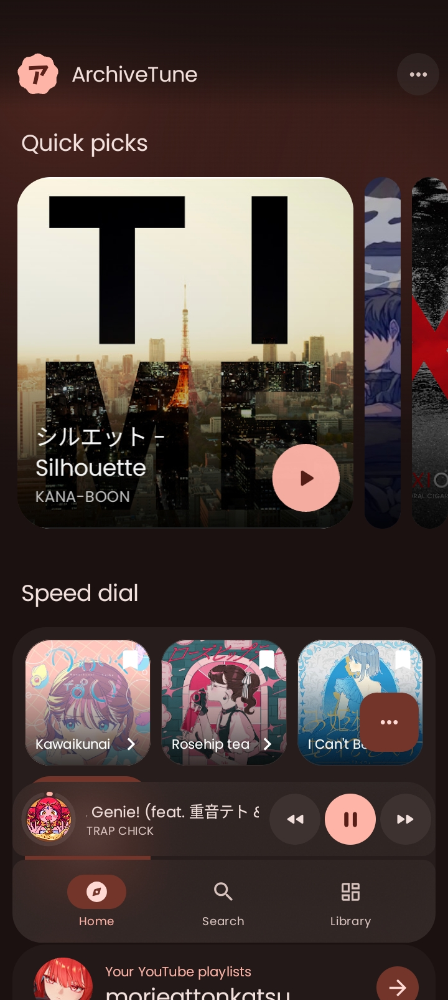
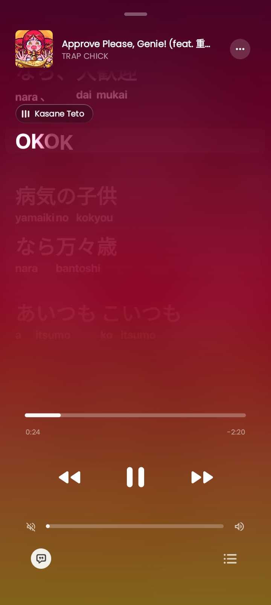
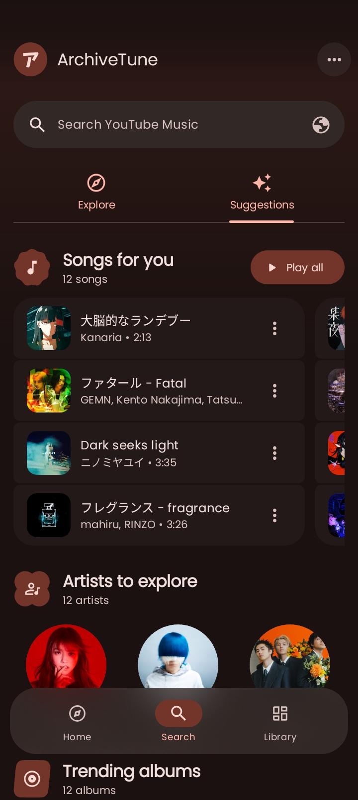
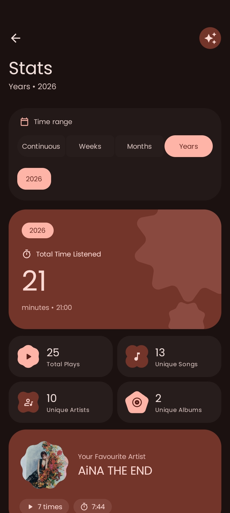
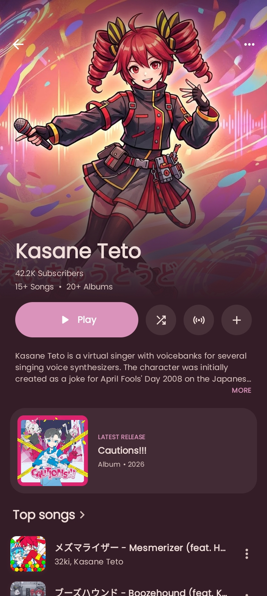
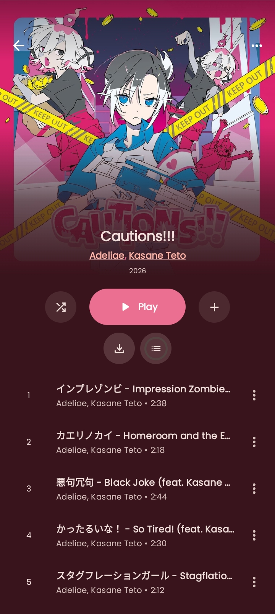
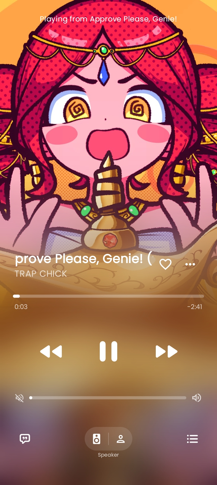
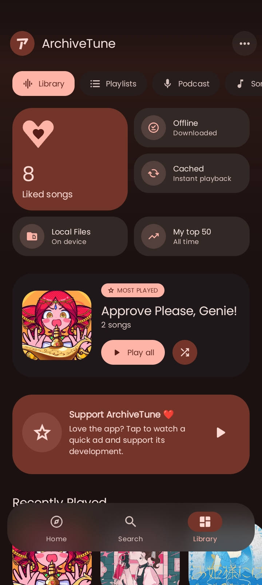
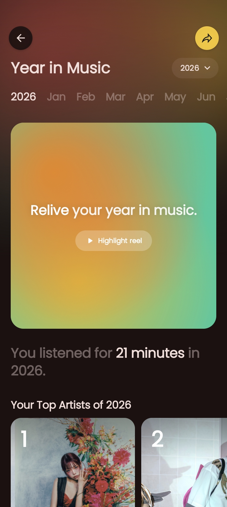
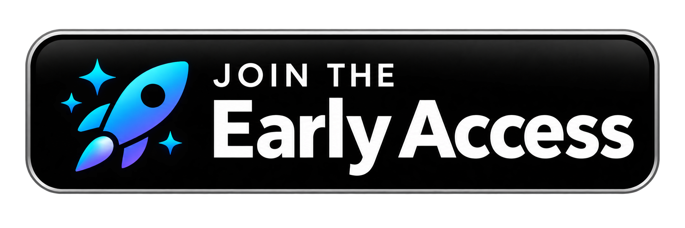

  

  <h1>ArchiveTune</h1>

  

    
    
  

  

    <strong>AndroidでのYouTube Music体験を再定義。</strong>
     
    <em>高性能でプライバシー重視、そして体験に本気でこだわる人のための機能を詰め込んだ音楽プレイヤーです。</em>
  

  

    <a href="https://archivetune.miuka.moe"><b>公式サイト</b></a> •
    <a href="#features"><b>機能</b></a> •
    <a href="https://archivetune.miuka.moe/privacy"><b>プライバシー</b></a> •
    <a href="#download-now"><b>ダウンロード</b></a> •
    <a href="#screenshots"><b>スクリーンショット</b></a> •
    <a href="https://github.com/rukamori/ArchiveTune/issues/new/choose"><b>サポート</b></a>
  

  

    
    
    
    
    
    
    
  

 

  
  

  

  

> [!CAUTION]
> **なりすまし警告 — ArchiveTune は Google Play で配信されていません**
>
> **ArchiveTune には公式の Google Play ストア掲載はありません。** ArchiveTune のメンテナーは、ArchiveTune の名称で Google Play 上のいかなるアプリも**公開・許可・承認していません**。
>
> **ArchiveTune の名称、ロゴ、アプリアイコン、スクリーンショット、その他の公式ブランディング**を使用している Google Play の掲載は、たとえ本プロジェクトとまったく同じに見えても、**非公式のサードパーティによる掲載**です。これらは **ArchiveTune のメンテナーによって検証もサポートもされておらず**、**公式リリースと誤認すべきではありません**。その内容や安全性は保証できません。
>
> **公式の ArchiveTune は、信頼できる配布元からのみ入手してください:** [GitHub Releases](https://github.com/rukamori/ArchiveTune/releases/latest)、[Obtainium（公式 GitHub リポジトリ経由）](https://apps.obtainium.imranr.dev/redirect?r=obtainium://add/https://github.com/rukamori/ArchiveTune/)、またはアーリーアクセス版は[公式 ArchiveTune Discord](https://discord.gg/archivetune) で提供されています。
>
> ArchiveTune になりすました Google Play の掲載を見つけた場合は、**Google Play に報告**し、[メンテナーにお知らせください](https://github.com/rukamori/ArchiveTune/issues/new/choose)。

---

> [!WARNING]
**フォーク版は一切サポートしていません。**  
本プロジェクトのフォーク版について、サポート、メンテナンス、トラブルシューティング、その他いかなる支援も提供しません。
フォーク版を使用する場合は、自己責任でご利用ください。

**ArchiveTune** は、ありきたりなYouTube Musicラッパーではありません。Kotlin と Jetpack Compose で一から作り上げた完全カスタムの音楽プレイヤーです。音楽はプライベートであるべきで、見た目はすっきりと、そして期待どおりに動くべきだと私たちは考えています。

---

> [!IMPORTANT]  
> **利用可能地域:** お住まいの地域でYouTube Musicがサポートされていない場合、初回のデータ取得には対応地域に設定したVPNまたはプロキシが必要です。

---

## 📸 ショーケース

---

## ✨ 機能

<table>
  <tr>
    <td width="50%" valign="top">
      

        <h3>再生</h3>
        <ul>
          <li>複数アカウント対応とすばやい切り替え</li>
          <li>広告なし再生とバックグラウンド再生</li>
          <li>SponsorBlock 対応</li>
          <li>ログイン後にプレイリスト・高く評価した曲・登録チャンネルを表示</li>
          <li>ローカルファイルおよびローカル楽曲の再生に対応</li>
          <li>カスタマイズ可能なプレイヤーと通知インターフェース</li>
          <li>Android Auto に幅広く対応</li>
          <li>高速起動と軽快なパフォーマンス</li>
          <li>プライベートで途切れないリスニング体験のための設計</li>
        </ul>
      

    </td>
    <td width="50%" valign="top">
      

        <h3>オーディオ</h3>
        <ul>
          <li>EBU R128 ラウドネス正規化</li>
          <li>ビットパーフェクト再生と DAC 対応</li>
          <li>テンポ・ピッチ・再生速度の調整</li>
          <li>トラック間のクロスフェード</li>
          <li>カスタマイズ可能なイコライザー、システムイコライザーおよび空間オーディオとの連携</li>
          <li>ハイレゾ音源再生モジュール</li>
        </ul>
      

    </td>
  </tr>
  <tr>
    <td width="50%" valign="top">
      

        <h3>歌詞 &amp; 発見</h3>
        <ul>
          <li>リアルタイム同期歌詞</li>
          <li>Apple Music のような歌詞表示</li>
          <li>歌詞翻訳、AIによる歌詞翻訳とローマ字表記</li>
          <li>周囲で流れている曲の音楽認識</li>
          <li>好きなときに確認できるリスニング統計</li>
        </ul>
      

    </td>
    <td width="50%" valign="top">
      

        <h3>同期 &amp; ソーシャル</h3>
        <ul>
          <li>Spotify からのプレイリストのインポート</li>
          <li>オンライン・オフラインでのバックアップと復元に対応</li>
          <li>YouTube Music アカウント連携</li>
          <li>Last.fm、Libre.fm およびカスタムスクロブリング</li>
          <li>ListenBrainz 履歴同期</li>
          <li>カスタマイズ可能な Discord リッチプレゼンス対応</li>
        </ul>
      

    </td>
  </tr>
  <tr>
    <td width="50%" valign="top">
      

        <h3>インターフェース</h3>
        <ul>
          <li>Material 3 Expressive で構築</li>
          <li>多彩にカスタマイズできるインターフェース</li>
          <li>アルバムアートに基づくダイナミックカラー</li>
          <li>最大11種類のプレイヤースタイル</li>
          <li>最大8種類のプレイヤー背景スタイル</li>
          <li>画面サイズに応じたレスポンシブレイアウト</li>
          <li>再生中のアニメーションアートワーク</li>
          <li>すっきりとしたブラウズ・プレイヤー・アーティスト・アルバム・歌詞画面</li>
        </ul>
      

    </td>
    <td width="50%" valign="top">
      

        <h3>カスタマイズ</h3>
        <ul>
          <li>詳細な再生およびインターフェース設定</li>
          <li>ダイナミックカラーのテーマオプション</li>
          <li>ジェスチャーのカスタマイズ</li>
          <li>アニメーションとレイアウトの調整</li>
          <li>使い方に合わせてアプリを形作れる柔軟な操作性</li>
        </ul>
      

    </td>
  </tr>
</table>

---

## モジュール開発

ArchiveTune は、ファイル・直接URL・カタログからインストールできる `.arch` プロバイダーパッケージに対応しています。パッケージ仕様、JavaScript API、設定スキーマ、ロスレスストリームの結果、パッケージングコマンド、公開手順については、公開されている[モジュール作成ガイド](MODULES.md)をご覧ください。

## 📥 今すぐダウンロード

<h2>安定版リリース</h2>

<table>
  <thead>
    <tr>
      <th align="center">Obtainium</th>
      <th align="center">IzzyOnDroid</th>
    </tr>
  </thead>
  <tbody>
    <tr>
      <td align="center">
        
      </td>
      <td align="center">
        
      </td>
    </tr>
    <tr>
      <th align="center" colspan="2">GitHub</th>
    </tr>
    <tr>
      <td align="center" colspan="2">
        
      </td>
    </tr>
  </tbody>
</table>

<h2>アーリーアクセスプログラム</h2>

アーリーアクセスプログラムに参加して、新機能・修正・改善をいち早く受け取りましょう

<table>
  <thead>
    <tr>
      <th align="center">アーリーアクセス</th>
    </tr>
  </thead>
  <tbody>
    <tr>
      <td align="center">
        
      </td>
    </tr>
  </tbody>
</table>

> [!WARNING]
> **公式ダウンロードのみ:** 上記の配布チャネルが ArchiveTune の信頼できる入手元です。**Google Play 上の掲載はいずれも公式の ArchiveTune リリースではありません。** ArchiveTune の名称やアイコンを流用したものを含め、サードパーティによるアップロードは本プロジェクトによって検証・保守・サポートされていません。その他の入手元からアプリをインストールする場合は自己責任でお願いします。

## ❓ お困りのこと・ご質問はありますか？
サポートやディスカッションには、Telegram チャンネルまたは Discord サーバーにご参加ください。

---

## 🌍 グローバリゼーション

ArchiveTune はすべての人のものです。あなたの地域向けのローカライズにご協力ください。

  

### ✨ プロジェクトのコントリビューター

### 🛠️ 開発 & エンジニアリング
プロジェクトのビルドや貢献に興味がありますか？ArchiveTune は高性能な Kotlin スタックで構築されています。
<a href="CONTRIBUTING.md"><b>ビルドと貢献のガイドを読む →</b></a>

---

### オープンソースへの謝辞

ArchiveTune は、多くのオープンソースプロジェクトとコミュニティの成果によって支えられています:

- **Metrolist**（[Mostafa Alagamy](https://github.com/mostafaalagamy/Metrolist)）— ベースフレームワーク
- **SimpMusic**（[maxrave-dev](https://github.com/maxrave-dev/SimpMusic)）— 歌詞APIプロバイダー
- [BetterLyrics](https://better-lyrics.boidu.dev/) — 単語単位の歌詞、ユニゾン、アートワークプロバイダーのサポート
- [Material Color Utilities](https://github.com/material-foundation/material-color-utilities)
- [Read You](https://github.com/Ashinch/ReadYou) と [Seal](https://github.com/JunkFood02/Seal) — UIコンポーネントのインスピレーション
- 引き続きプロジェクトを支えてくださる翻訳者、ベータテスター、コントリビューター、コミュニティメンバーの皆様

---

## ⚖️ 法的免責事項

ArchiveTune は独立したサードパーティ製クライアントです。
- Google LLC および YouTube とは提携していません。
- YouTube の技術的保護を回避するものではありません。
- 公式チャネルで音楽を購入し、アーティストを支援することをおすすめします。

## ⚖️ ライセンス、著作権、商標に関する通知

ArchiveTune は **GNU General Public License v3.0（GPLv3）** の下でライセンスされています。

GPLv3 を遵守する限り、商用目的を含め、ソースコードを複製・改変・再配布することができます。これには、該当する著作権表示およびライセンス表示の保持、改変版であることの明示、必要に応じた対応するソースコードの提供が含まれます。

Copyright © Rukamori および ArchiveTune コントリビューター（それぞれの独自の貢献について）。

**ArchiveTune™** の名称、ロゴ、アプリアイコン、および公式ブランディングは GPLv3 の下でライセンスされていません。非公式のフォークは、自らを公式の ArchiveTune リリースとして提示したり、ArchiveTune メンテナーによる承認を示唆したりしてはなりません。

**Google Play でのなりすまし:** メンテナーは、Google Play 上で公式の ArchiveTune リリースとしてアプリを公開すること、または公式な関係を誤って示唆する形で ArchiveTune のブランディングを再利用することを、誰にも許可していません。GPLv3 でライセンスされたコードをフォークまたは再配布する権利があっても、独自に公開されたアプリが公式の ArchiveTune 配布物になるわけでは**ありません**。

GPLv3 の全条項については [`LICENSE`](LICENSE) ファイルをご覧ください。

---

  
  
<b>ArchiveTune で音楽体験が向上したなら、ぜひ ⭐ をお願いします</b>

   
  

